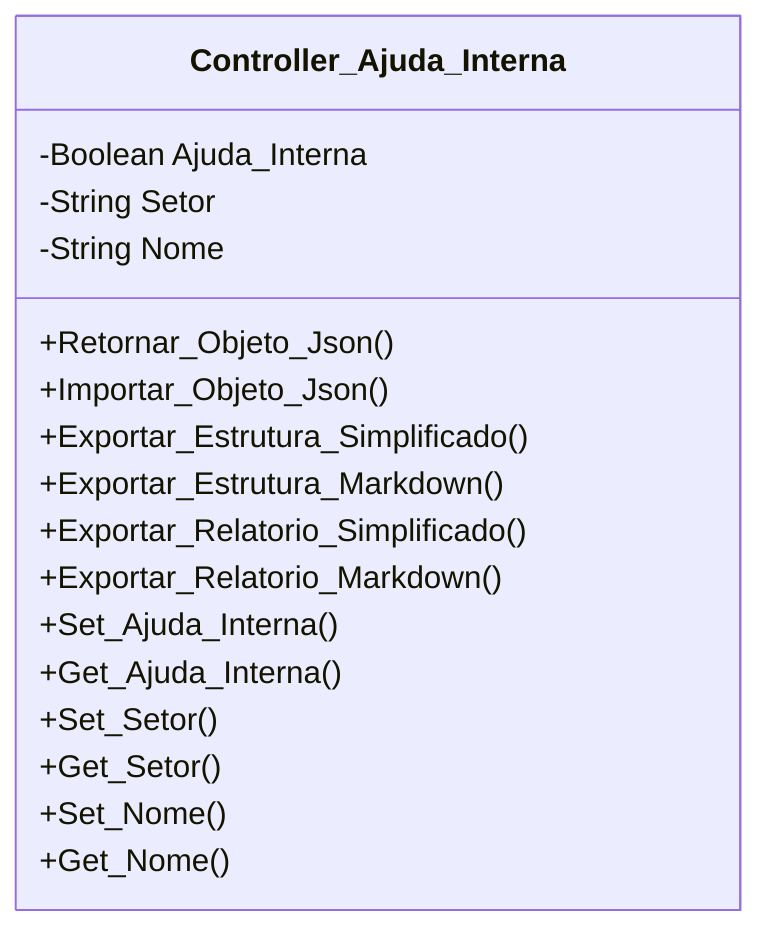

[↩️ Voltar](HOME)
```table-of-contents
```
---

Essa classe é responsável por gerir a ajuda interna que o técnico recebeu durante o atendimento ao cliente. Ela informa se o técnico recebeu ou não ajuda interna, e quem foi que auxiliou o mesmo. 

## Atributos
> [!cite]- Estrutura para uso
> ```
> - `(Tipo_Atributo) Nome_atributo`: Descrição...
> ```

- `(Boolean) Ajuda_Interna`: Padrão False, e em caso de verdadeiro, significa que o técnico recebeu ajuda interna;
- `(String) Setor`: Setor responsável por auxiliar o técnico;
- `(String) Nome`: Nome do técnico responsável pelo auxilio;
- 
## Métodos
> [!cite]- Estrutura para uso
> ```
> ### Nome do Método
> 
> Descrição...
> 
> **Parâmetros** 
> - `Nome_parametro`: Descrição
> 
> **Retorno**
> 	Descrição do retorno.
> ```
### Set_Ajuda_Interna

Altera o Valor de `True` para `False` e vice versa do atributo `Ajuda_Interna`, retornando o valor atual.

**Retorno**
	Retorna o valor atual do atributo `Ajuda_Interna`;
## Diagrama




