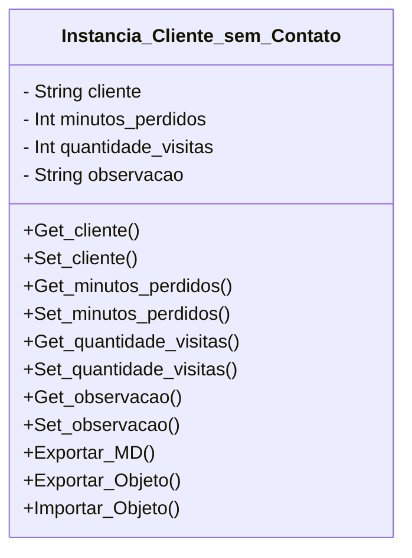

[↩️ Voltar](HOME)
```table-of-contents
```
---

Essa Classe tem por objetivo controlar os atributos relacionados aos relatórios de Cliente sem contato. Ela será importada como atributo da classe de [[Classe - Relatório Externo|Relatório Externo]]. 
## Atributos
> [!cite]- Estrutura para uso
> ```
> - `(Tipo_Atributo) Nome_atributo`: Descrição...
> ```

- `(String) cliente`: Nome do cadastro na OS
- `(Int) minutos_perdidos`: Tempo aproximado de espera em minutos com deslocamento e esperade contato pela Torre.
- `(Int) quantidade_visitas`: Quantas vezes já visitou no dia;
- `(String) observacao`: Em caso de observação adicional, adicione aq. 
## Métodos
> [!cite]- Estrutura para uso
> ```
> ### Nome do Método
> 
> Descrição...
> 
> **Parâmetros** 
> - `Nome_parametro`: Descrição
> 
> **Retorno**
> 	Descrição do retorno.
> ```
### Exportar_MD

Essa função é responsável por exportar os atributos desse relatório devidamente formatados em MD para observação pelo APP. 

**Retorno**
	Retorna o relatório para ser integrado a classe pai.
### Exportar_Objeto e Importar_Objeto

São métodos que irão encaminhar o objeto devidamente estruturado. Ele será integrado ao corpo da classe principal para encaminhar toda a estrutura para ser enviada ao relatório, e salvar no banco de dados. 
## Diagrama




