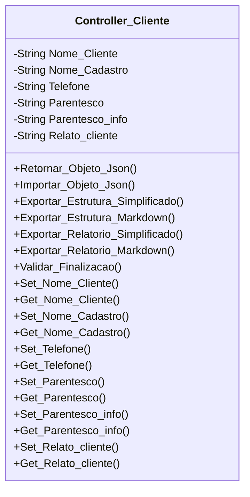

[↩️ Voltar](HOME)
```table-of-contents
```
---

Classe responsável por todos os atributos relacionados aos clientes. 

## Atributos

- `(String) Nome_Cliente`: Nome de quem acompanhou a visita;
- `(String) Nome_Cadastro`: Nome do cadastro da OS;
- `(String) Telefone`: Número de contato;
- `(String) Parentesco`: Titular, Esposa'o, Filho'a, Funcionário, Avó'ô, Tio'a, 
- `(String) Parentesco_info`: Em caso de outros
- `(String) Relato_cliente:`: O problema relatado pelo cliente, obrigatório ser preenchido!

- 
## Métodos

### Validar_Finalizacao

Valida se o técnico preencheu o Nome do Cliente, Nome do Cadastro, Telefone, Parentesco e o mais importante de todos: Relato do Cliente. 
### Nome do Método

Descrição...

**Parâmetros** 
- `Nome_parametro`: Descrição

**Retorno**
	Descrição do retorno.
## Diagrama




