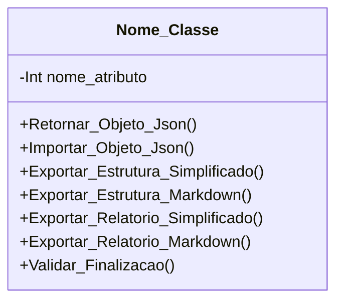

[↩️ Voltar](HOME)
```table-of-contents
```
---

Classe responsável por todos os atributos relacionados aos clientes. 

## Atributos

- `(String) Nome_Cliente`: Nome de quem acompanhou a visita;
- `(String) Nome_Cadastro`: Nome do cadastro da OS;
- `(String) Telefone`: Número de contato;
- `(String) Parentesco`: Titular, Esposa'o, Filho'a, Funcionário, Avó'ô, Tio'a, 
- `(String) Parentesco_info`: Em caso de outros
- `(String) Relato_cliente:`: O problema relatado pelo cliente, obrigatório ser preenchido!

- 
## Métodos

### Validar_Finalizacao()
### Nome do Método

Descrição...

**Parâmetros** 
- `Nome_parametro`: Descrição

**Retorno**
	Descrição do retorno.
## Diagrama



```json
{
    "config_OS": {
        "tipo_os": "completa",
        "finalizada": false,
        "info_encaminhadas": true,
        "id": null,
        "data_criacao": "2026-09-28T15:49:19.4682-03:00[America/Sao_Paulo]",
        "data_alteracao": null,
        "usado_resumo_ia": false,
        "power_mitter": null
    },
    "info_cliente": {
        "nome_cliente": null,
        "nome_cadastro": null,
        "parentesco": null,
        "parentesco_info": null,
        "relato_cliente": null,
        "telefone": null
    },
    "endereco_info_os": {
        "coordenadas": {
            "latitude": -24.179749402506804,
            "longitude": -46.78260597109993,
            "precisao": 77
        },
        "anexo_fachada": false,
        "info_necessaria": true,
        "complemento_info_necessaria": {
            "requerimentos": [],
            "operador": null,
            "info_padrao": {
                "historico": false,
                "comodato": false,
                "descricao": false,
                "contratacao": false
            }
        }
    },
    "conferencia_tecnica": {
        "cabos_utp": [],
        "fontes": {
            "mau_contato": true,
            "amperagem": true,
            "uso": true,
            "observacao": null
        },
        "fibra": {
            "sinal_pto": null,
            "sinal_pathcord": null,
            "sinal_autoisp": null,
            "anexo_sinal": true,
            "limpeza": true,
            "observacao": null
        },
        "conferencia_router": [],
        "teste_navegacao": [
            {
                "ativos_cliente": false,
                "tipo_ativo": "celular",
                "observacao": null
            },
            {
                "ativos_cliente": false,
                "tipo_ativo": "computador",
                "observacao": null
            },
            {
                "ativos_cliente": true,
                "tipo_ativo": "celular",
                "observacao": null
            }
        ],
        "mapa_calor": {
            "realizado": false,
            "pontos_sobra": false,
            "ponto_adicional": null,
            "observacao": null
        },
        "ping_adicional": [],
        "observacao_ping": null,
        "tracert_adicional": [],
        "observacao_tracert": null,
        "velocidade_adicional": [],
        "observacao_velocidade": null,
        "encaminhar_externa": {
            "necessidade": false,
            "observacao": null
        },
        "equipamentos_local": {
            "troca": false,
            "pppoe": null,
            "cod_conexao": null,
            "motivo_troca": "solicitacao_cliente",
            "observacao": null,
            "ativos": [
                {
                    "ativo": "ONT",
                    "mac": "fsdfsdfsdfsd",
                    "inserido": true
                },
                {
                    "ativo": "ONT",
                    "mac": "sdfsdfsdfsd",
                    "inserido": true
                },
                {
                    "ativo": "Router",
                    "mac": "fsdfsdfsdfsd",
                    "inserido": false
                }
            ]
        }
    },
    "ajuda_interna": {
        "verdadeiro": false,
        "setor": "Torre",
        "nome": null
    },
    "indicacao": {
        "solicitado": false,
        "indicado": false,
        "nome": null,
        "contato": null,
        "encaminhada": false
    },
    "educacao_cliente": {},
    "atendimento_cliente": {},
    "complemento_atendimento": [],
    "relato_adicional": null,
    "relatorio_estabilidade": null,
    "relatorio_externo": null,
    "relato_omissao": null,
    "relato_atraso": null
}
```


