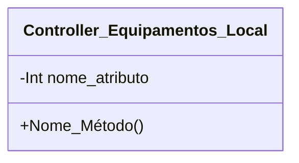

[↩️ Voltar](HOME)
```table-of-contents
```
---

Essa classe tem a responsabilidade de gerir todas as regras de negocio relacionadas a troca de ativos, e sobre a troca de equipamentos. 

## Atributos
> [!cite]- Estrutura para uso
> ```
> - `(Tipo_Atributo) Nome_atributo`: Descrição...
> ```

- `(Tipo_Atributo) Nome_atributo`: Descrição...
## Métodos
> [!cite]- Estrutura para uso
> ```
> ### Nome do Método
> 
> Descrição...
> 
> **Parâmetros** 
> - `Nome_parametro`: Descrição
> 
> **Retorno**
> 	Descrição do retorno.
> ```


## Diagrama




