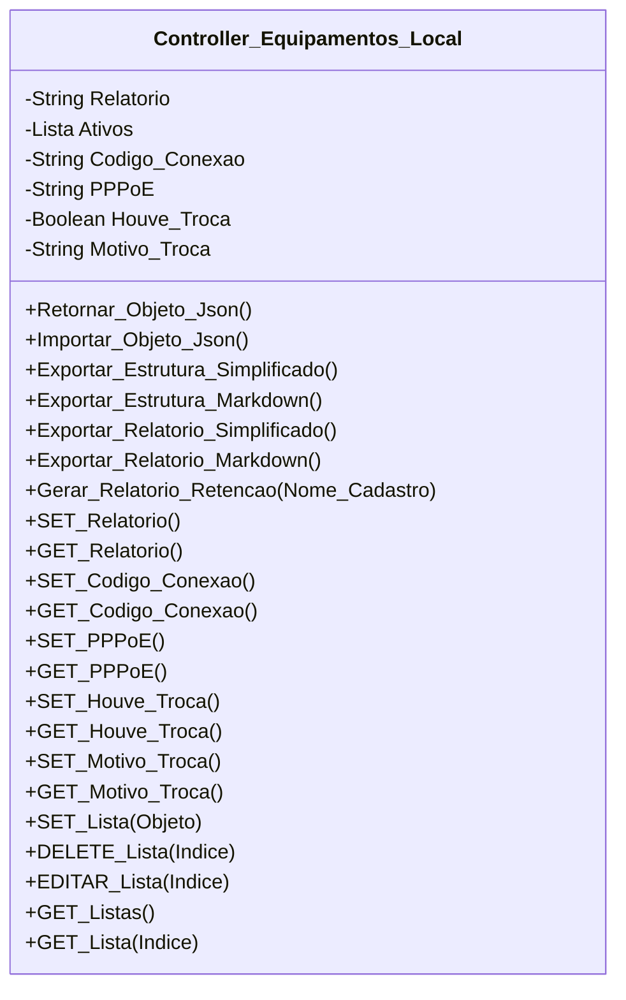

[↩️ Voltar](HOME)
```table-of-contents
```
---

Essa classe tem a responsabilidade de gerir todas as regras de negocio relacionadas a troca de ativos, e sobre a troca de equipamentos. 

O atributo `Ativos` será uma lista de objetos de ativos que poderemos manipular. Essa lista tem a seguinte estrutura: 

`Objeto Ativo`
```Json
{
	Ativo: "", //Lista de Ativos da Empresa
	SN: "", //Numero Serial do ativo inserido
	Retirado: false, //Informa que o ativo foi retirado
	Inserido: false, //Informa que o ativo foi inserido
	Local: false, //Informa que o ativo já estava no local
	Danificado: false, 
	Autorizado_Troca: false, //Em caso de danificado.
	Relatorio: null, //Relatório especifico sobre o router do local.  
	
}
```

O Atributo `Ativo` recebe o valor a partir da [[Variáveis de Lista Exportadas - Lista de Tipos de ativos da Empresa|Lista de Ativos da Empresa]]. 

Os atributos `Retirado`, `Inserido` e `Local` tem ligação e apenas um deles por ativo pode ser verdadeiro. 

o Atributo `Relatorio` de um ativo especifico deverá ser usado quando o mesmo estiver danificado, e for necessário a troca. Nesse caso é interessante seguir uma certa estrutura de relatório para o ativo quando o mesmo estiver danificado. Essa regra foi retirada do IT de Permissão de troca de ativos, e deve ser a seguinte:

- Descrição do defeito/dano constatado;
- Provável causa do problema;
- Informação sobre reincidência do caso no mesmo endereço (quando aplicável).

## Atributos
> [!cite]- Estrutura para uso
> ```
> - `(Tipo_Atributo) Nome_atributo`: Descrição...
> ```

- `(String) Relatorio`: Relatório geral relacionado a trocas de ativos ou ativos que já estão no local.
- `(Lista) Ativos`: Lista de todos os ativos no local;
- `(String) Codigo_Conexao`: Código de conexão do cliente retirado da OS;
- `(String) PPPoE`: PPPoE do cliente retirado da OS;
- `(Boolean) Houve_Troca`: Indica se existiu a troca de ativos no local ou não;
- `(String) Motivo_Troca`: Qual foi o motivo da troca, o valor será atribuído a partir da [[Variáveis de Lista Exportadas - Lista de Motivos de Troca|lista de motivos de troca]];
## Métodos
> [!cite]- Estrutura para uso
> ```
> ### Nome do Método
> 
> Descrição...
> 
> **Parâmetros** 
> - `Nome_parametro`: Descrição
> 
> **Retorno**
> 	Descrição do retorno.
> ```
### Gerar_Relatorio_Retencao

Essa função é responsável por gerar o relatório formatado para ser encaminhado a retenção. 

Formato de Retorno esperado

`Texto Formatado para Whatsapp`
```
*Nome do Cadastro (PPPoE)*:
*S.N. do Ativo Retirado*: 000000
Relatório Técnico:
> Descrição do defeito/dano constatado. Provável causa do problema. Informação sobre reincidência do caso no mesmo endereço (quando aplicável).
```

Essa função só irá funcionar se o atributo PPPoE for adicionado ao relatório, e o Relatório do ativo danificado for devidamente cadastrado. Caso contrário, a função retornar um erro e um Alerta de acordo com a dificuldade encontrada: 

- Alerta de PPPoE não cadastrado: `É necessário adicionar o PPPoE do cliente no formulário`
- Alerta de Relatório não cadastrado: `Ativo danificado sem relatório válido para gerar mensagem!`;
- Alerta de Equipamento danificado não encontrado: `Não foi possível localizar o ativo danificado, por gentileza verifique se o mesmo foi marcado!`;

**Parâmetros** 
- `Nome_Cadastro`: Nome do cadastro do cliente, já que essa informação não pode ser capturada dentro da classe. Por padrão, se esse valor for omitido, o programa adiciona "`Não Informado`" como padrão. 

**Retorno**
	Retorna uma String formatada para ser copiada para a área de transferência. 
## Diagrama




