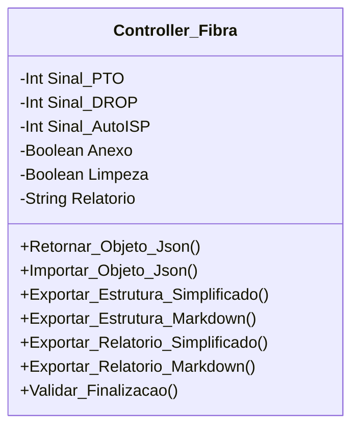

[↩️ Voltar](HOME)
```table-of-contents
```
---

Classe relacionada a conferência da Fibra no Cliente.

## Atributos
> [!cite]- Estrutura para uso
> ```
> - `(Tipo_Atributo) Nome_atributo`: Descrição...
> ```

- `(Int) Sinal_PTO`: Sinal da fibra capturado diretamente da PTO
- `(Int) Sinal_DROP`: Sinal da fibra capturado diretamente do DROP
- `(Int) Sinal_AutoISP`: Sinal da fibra capturado diretamente do AutoISP
- `(Boolean) Anexo`: Foto do sinal em anexo;
- `(Boolean) Limpeza`: Se foi realizado a limpeza do Drop/Pathcord, por padrão, inicia-se como `false`. 
- `(String) Relatorio`: Relatório Geral relacionado a fibra.
## Métodos
> [!cite]- Estrutura para uso
> ```
> ### Nome do Método
> 
> Descrição...
> 
> **Parâmetros** 
> - `Nome_parametro`: Descrição
> 
> **Retorno**
> 	Descrição do retorno.
> ```

### Validar_Finalizacao

A validação da Fibra ocorre em duas etapas. A primeira e mais importante é verificar se nenhum sinal foi anexado. Caso ocorre, ele retorna a mensagem: `Nenhum Sinal de fibra anexado ao relatório!`. Já a segunda, valida se foi realizado a limpeza do conector, caso seja falso, retorna uma mensagem: `Você não realizou a limpeza da Fibra no local`

**Parâmetros** 
- `Nome_parametro`: Descrição

**Retorno**
	Descrição do retorno.
## Diagrama




