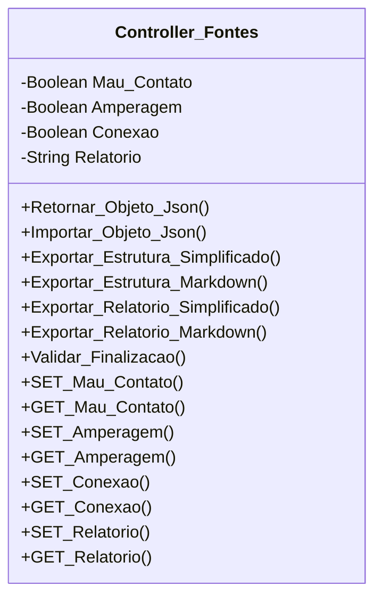

[↩️ Voltar](HOME)
```table-of-contents
```
---

Classe responsável pela checagem das fontes no local. Os atributos de `Mau_Contato`, `Amperagem`
e `Conexao` devem ser iniciados como **falso** para evitar falso positivo do qual o técnico não valida os atributos e relata da baixa geral que não realizou nenhum teste.
## Atributos
> [!cite]- Estrutura para uso
> ```
> - `(Tipo_Atributo) Nome_atributo`: Descrição...
> ```

- `(Boolean) Mau_Contato`: Atributo Booleano que armazena verdadeiro ou falso para validar se foi verificado questões de mau contato no local.
- `(Boolean) Amperagem`: Atributo Booleano que armazena verdadeiro ou falso para validar se foi verificado a amperagem correta do dispositivo.
- `(Boolean) Conexao`: Atributo Booleano que armazena verdadeiro ou falso para validar se foi verificado o mau uso, ou seja, se está ligado em benjamins ou na gambiarra.
- `(String) Relatorio`: Aqui é onde iremos justificar caso o técnico não realize o check em alguns desses campos. 
## Métodos
> [!cite]- Estrutura para uso
> ```
> ### Nome do Método
> 
> Descrição...
> 
> **Parâmetros** 
> - `Nome_parametro`: Descrição
> 
> **Retorno**
> 	Descrição do retorno.
> ```
### Validar_Finalizacao

Esse método valida a finalização verificando se todos os atributos foram validados. Caso exista algum item não checkado, e o campo de relatório esteja vazio, o método retorna false. 

**Retorno**
	Lista do qual o primeiro índice é `True` ou `False`, enquanto o segundo índice é a mensagem em caso de false, nesse caso: `Você não justificou no relatório o motivo de não ter feito a conferência técnica <tal> nas fontes`
## Diagrama




