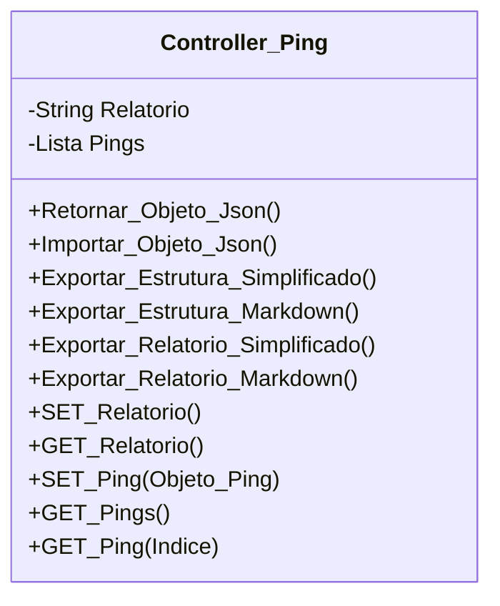

[↩️ Voltar](HOME)
```table-of-contents
```
---

Classe responsável pelas regras de negócio geral do ping e tracert. A lista de pings vai conter um objeto de ping, que pode ser inserido manualmente, ou através de sistemas automáticos de teste, como o NetScanQR. Porém, esses dados externos não podem permitir edição;

`Objeto Ping`
```json
{
	Latencia: ["Min", "Med", "Max"],
	Pacotes: ["Enviados", "Recebidos", "Perdidos"],
	Protocolo: "", // Vlaor atribuido a partir da lista de protocolos
	Ativo: "Empresa/Cliente",
	Destino: "", //Valor da lista de Destinos de IP's
	Lock: false, //define se podemos ou não editar o item da lista.
}
```

O Atributo `Procoloco` recebe um valor extraído da [[Variáveis de Lista Exportadas - Lista de Protocolos|Lista de Protocolos]], já o atributo `Destino` recebe um valor da [[Variáveis de Lista Exportadas - Lista de Destinos de IP's|Lista de Destinos]]. 

## Atributos
> [!cite]- Estrutura para uso
> ```
> - `(Tipo_Atributo) Nome_atributo`: Descrição...
> ```

- `(String) Relatorio`: Relatório geral dos testes de ping;
- `(Lista) Pings`: Lista de Todos os pings testados no local; 
## Métodos
> [!cite]- Estrutura para uso
> ```
> ### Nome do Método
> 
> Descrição...
> 
> **Parâmetros** 
> - `Nome_parametro`: Descrição
> 
> **Retorno**
> 	Descrição do retorno.
> ```

## Diagrama




