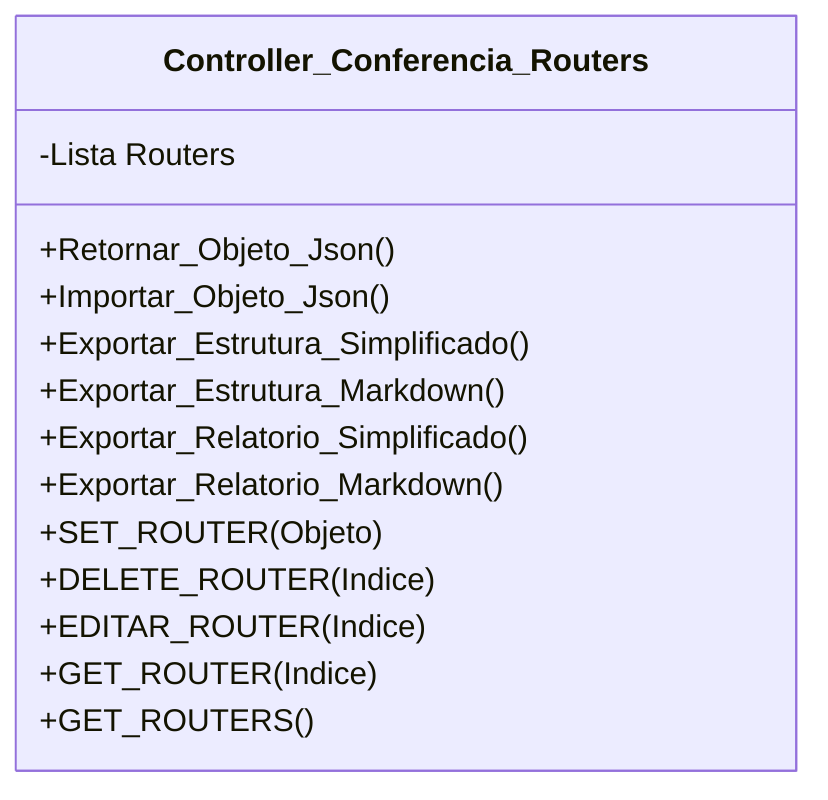

[↩️ Voltar](HOME)
```table-of-contents
```
---
## Introdução

Essa Classe faz a gestão dos routers testados no local, por padrão seu atributo principal é uma Lista que contem os ativos testados no local. Cada objeto Router irá conter o seguinte atributo:

`Objeto Router`
```json
{
	Acesso_Remoto: true,
	Primeiro_Ponto: true,
	Relatorio_Router: null, //Relatório particular do Router
	Atividade: {
		Anormal: false, 
		Valor: 0 //Tempo de Dias que o ativo está ligado 
	},
	Conexoes: {
		Anormal: false, 
		Valor: 0 //Quantidade de Ativos conectados ao Router. 
	},
	DNS: "ETECC",// Lista Externa de dados
	UPNP: true, //Caso o UPNP esteja ativo 
	Ativo_Empresa: true, //Informa se é um ativo da empresa ou do cliente;
	Firware_Atualizado: true, //Informa se o firware está atualizado;
	IPV6_SLAAC: true, //Informa que o IPV6 está habilitado;
	Largura_Banda_2G: "20MHz",
	Largura_Banda_5G: "150MHz",
	Local: {
		Localizacao: "Sala",
		Adequado: true, //Se o local é adequado para o equipamento;
		Cliente_Ciente: true, //Cliente ciente que aquele local é inadequado
		Observacao: null, //Relatório caso o local não seja adequado.
	}
}	
```

Essa classe possui os métodos `Exportar_Relatorio_Simplificado` e `Exportar_Relatorio_Markdown` que exportam o atributo `Relatorio_Router` devidamente formatado tanto para o relatório do MK quanto para o relatório em Markdown.
### Referências

- [[Variáveis de Lista Exportadas - Lista de DNS]]
## Atributos
> [!cite]- Estrutura para uso
> ```
> - `(Tipo_Atributo) Nome_atributo`: Descrição...
> ```

- `(Lista) Routers`: Lista que recebe Objetos que representam os Routers testados no local. 
## Métodos
> [!cite]- Estrutura para uso
> ```
> ### Nome do Método
> 
> Descrição...
> 
> **Parâmetros** 
> - `Nome_parametro`: Descrição
> 
> **Retorno**
> 	Descrição do retorno.
> ```


## Diagrama




