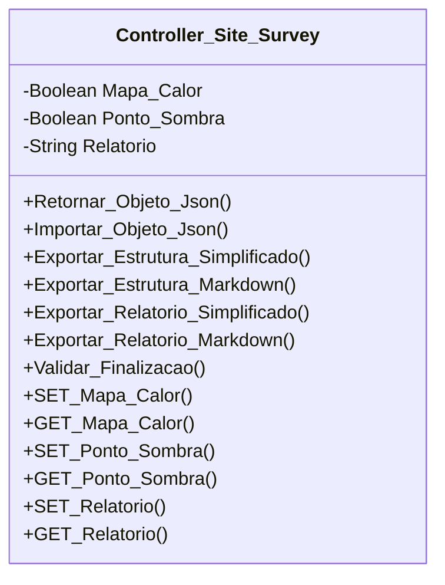

[↩️ Voltar](HOME)
```table-of-contents
```
---

Classe responsável por gerenciar toda a regra de negócio relacionada ao mapa de calor. 
## Atributos
> [!cite]- Estrutura para uso
> ```
> - `(Tipo_Atributo) Nome_atributo`: Descrição...
> ```

- `(Boolean) Mapa_Calor`: Booleano que indica se foi realizado o mapa de calor ou não;
- `(Boolean) Ponto_Sombra`: Booleano que indica se foi observado pontos de sombra;
- `(String) Relatorio`: Relatório relacionado ao ponto de sombra;
- 
## Métodos
> [!cite]- Estrutura para uso
> ```
> ### Nome do Método
> 
> Descrição...
> 
> **Parâmetros** 
> - `Nome_parametro`: Descrição
> 
> **Retorno**
> 	Descrição do retorno.
> ```
### Validar_Finalizacao

Esse método valida se foi realizado mapa de calor, caso o atributo seja negativo, o mesmo verifica se o `Relatorio` está vazio, se positivo, ele retorna um Erro: `Não foi verificado ou justificado o mapa de calor!`. Vale lembrar que o relatório em si, não pode estar vazio, então, caso tenha sido realizado o mapa de calor, mas o relatório está vazio, ele retornar a mensagem de alerta: `Você não escreveu nenhum relatório relacionado ao mapa de calor em seu campo definido!`

**Retorno**
	Uma lista de Verdadeiro ou falso no primeiro índice, e uma mensagem de alerta caso o retorno seja falso.
## Diagrama




