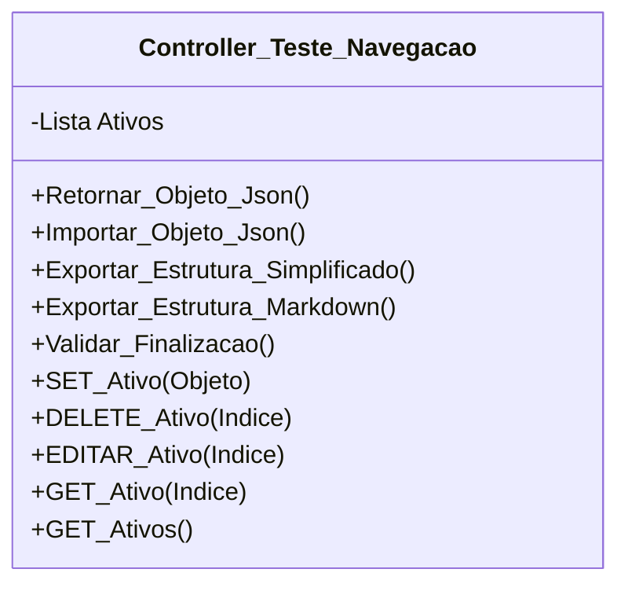

[↩️ Voltar](HOME)
```table-of-contents
```
---

Classe responsável pela gestão dos ativos que foram testados no local. Esse classe faz a gestão de uma lista de ativos testados no local, cada item segue a seguinte estrutura:

`Objeto Ativos`
```json
{
	Ativo_Empresa: true, //Indica se o ativo é da empresa ou do cliente
	Categoria: "", //Vinculado a partir da lista de Tipos de Ativos de Teste
	Relatorio: null, //Relatório geral do ativo testado quando adequado	
}
```

- [[Variáveis de Lista Exportadas - Lista de Tipos de ativos de Teste]]
## Atributos
> [!cite]- Estrutura para uso
> ```
> - `(Tipo_Atributo) Nome_atributo`: Descrição...
> ```

- `(Lista) Ativos`: Lista de todos os ativos testados no local.

## Métodos
> [!cite]- Estrutura para uso
> ```
> ### Nome do Método
> 
> Descrição...
> 
> **Parâmetros** 
> - `Nome_parametro`: Descrição
> 
> **Retorno**
> 	Descrição do retorno.
> ```
### Validar_Finalizacao

Essa método irá validar, primeiro, se foi testado algum ativo, seja da empresa ou do cliente, se não foi vinculado nenhum ativo, a mesma irá retornar um erro: `Nenhum ativo de teste vinculado ao relatório`. E caso o técnico tenha colocado ativos da empresa, mas nenhum desses ativos é do cliente, o mesmo irá retornar outro alerta: `Não foi identificado testes nos ativos do cliente`.

**Parâmetros** 
- `Nome_parametro`: Descrição

**Retorno**
	Uma lista de Verdadeiro ou falso no primeiro índice, e uma mensagem de alerta caso o retorno seja falso.
## Diagrama




