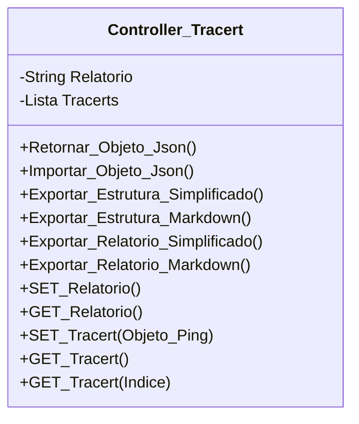

[↩️ Voltar](HOME)
```table-of-contents
```
---

Classe responsável pelas regras de negocio do Tracert. 

Assim como o ping, o a lista de `Tracerts` recebe um objeto pré estruturado:

`Objeto Tracert`
```Json
{
	Ativo: "Empresa/Cliente",
	Destino: "",//Capturado da lista de destinos
	Protocolo: "", //Capturado da lista de protocolos
}
```

O atributo `Destino` recebe um valor que será retirado da [[Variáveis de Lista Exportadas - Lista de Destinos de IP's|Lista de Destinos]] já pré estabelecida. E o atributo `Protocolo` recebe um valor extraído da [[Variáveis de Lista Exportadas - Lista de Protocolos|Lista de Protocolos]]
## Atributos
> [!cite]- Estrutura para uso
> ```
> - `(Tipo_Atributo) Nome_atributo`: Descrição...
> ```

- `(String) Relatorio`: Relatório geral do Tracert
- `(Lista) Tracerts`: Todos os objetos tracerts vinculados a OS.
## Métodos
> [!cite]- Estrutura para uso
> ```
> ### Nome do Método
> 
> Descrição...
> 
> **Parâmetros** 
> - `Nome_parametro`: Descrição
> 
> **Retorno**
> 	Descrição do retorno.
> ```


## Diagrama




