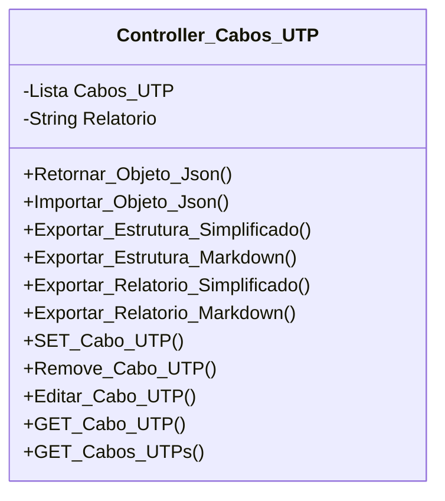

[↩️ Voltar](HOME)
```table-of-contents
```
---

Essa classe gerencia todos os atributos relacionados a cabos UTP's de rede, e telefonia. O principal atributo da classe é a lista de cabos. Cada item dessa lista é um objeto estruturado da seguinte forma:

`Lista de Cabos`
```json
{
	Categoria: "WAN", //Poder ser WAN, ou o dispositivo que representa.Exe.: Segundo ponto.
	Relatorio: "Descrição curta do cabo testado",
	Anexo: false, //Se foi anexado alguma foto do cabo.
	Testes:{
		Velocidade: false,
		Ping: false,
		Powermitter: false,
	}	
}
```
## Atributos
> [!cite]- Estrutura para uso
> ```
> - `(Tipo_Atributo) Nome_atributo`: Descrição...
> ```

- `(Lista) Cabos_UTP`: Lista de todos os cabos UTPs testados no local;
- `(String) Relatorio`: Relatório geral relacionado aos cabos UTPs;
- 
## Métodos
> [!cite]- Estrutura para uso
> ```
> ### Nome do Método
> 
> Descrição...
> 
> **Parâmetros** 
> - `Nome_parametro`: Descrição
> 
> **Retorno**
> 	Descrição do retorno.
> ```

## Diagrama




