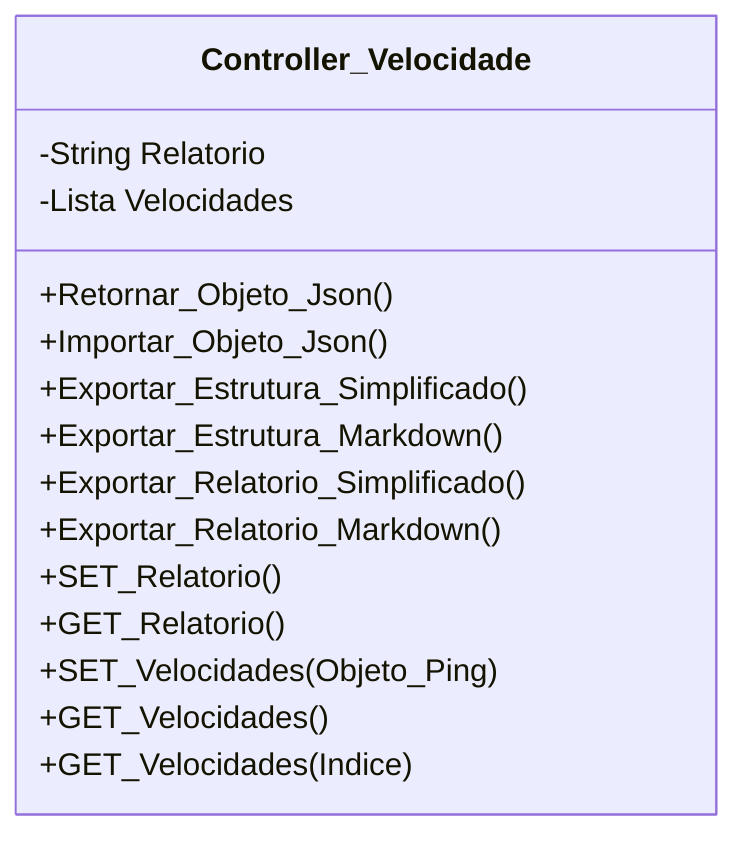

[↩️ Voltar](HOME)
```table-of-contents
```
---

Classe responsável pelas regras de negocio dos testes de velocidade. 

Assim como a classe de Ping e Tracert, velocidade possui objetos de velocidade que são os valores adicionados ao relatório:

`Objeto Velocidade`
```json
{
	Equipamento: "", //Lista retirada da lista de ativos
	Ativos: "Empresa/Cliente",
	Down: 0,
	UP: 0,
	Ping: 0,
	Jitter:0,
	URL: null, //URL do teste de velocidade. Retornando de testes externos.
	Categoria: "Cabo/Wifi",
	Site: ""   //Retirado da lista de teste de velocidade. 
}
```

O atributo `Ativos` informa em qual ativo foi realizado o teste de velocidade, ele vem diretamente da [[Variáveis de Lista Exportadas - Lista de Tipos de ativos de Teste|Lista de Ativos]]. Já a lista de Sites é retirada da variável de [[Variáveis de Lista Exportadas - Lista de Teste de Velocidade|Sites de Teste]].  
## Atributos
> [!cite]- Estrutura para uso
> ```
> - `(Tipo_Atributo) Nome_atributo`: Descrição...
> ```

- `(String) Relatorio`: Relatório geral do Tracert
- `(Lista) Velocidades`: Todos os objetos de velocidade vinculados a OS.
## Métodos
> [!cite]- Estrutura para uso
> ```
> ### Nome do Método
> 
> Descrição...
> 
> **Parâmetros** 
> - `Nome_parametro`: Descrição
> 
> **Retorno**
> 	Descrição do retorno.
> ```


## Diagrama




