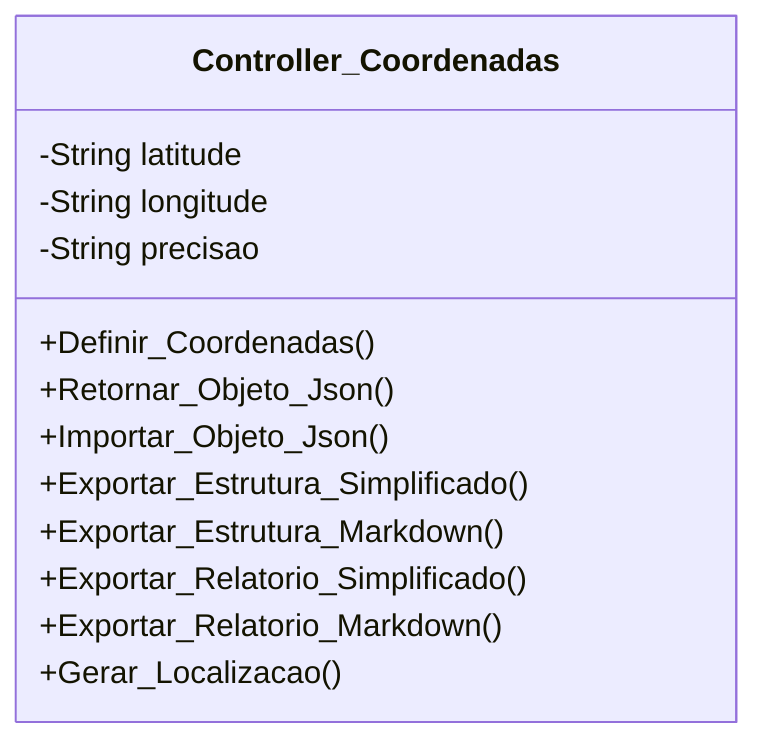

[↩️ Voltar](HOME)
```table-of-contents
```
---

O Objeto de Coordenadas é responsável por gerar as coordenadas da OS na primeira inicialização de Ordens de Serviço.

Para a geração da **localização** basta usar o template: `https://www.google.com/maps?q=<Latitude>,<Longitude>`
## Atributos

- `(String) latitude`: Latitude retornada da função de geolocalização;
- `(String) longitude`: Longitude retornada da função de geolocalização;
- `(String) precisao`: Precisão retornada da função de geolocalização;
- `(String) localizacao`: Localização gerada para o Google maps usando os valores de coordenada;

## Métodos

### Definir_Coordenadas

Define as coordenadas atuais do técnico. Esse método será chamado assim que uma OS for iniciada pela primeira vez, definindo os atributos.
### Gerar_Localizacao

Usado para formatar a estrutura do atributo de localização a partir dos atributos de latitude e longitude. 

**Retorno:**
	
## Diagrama


