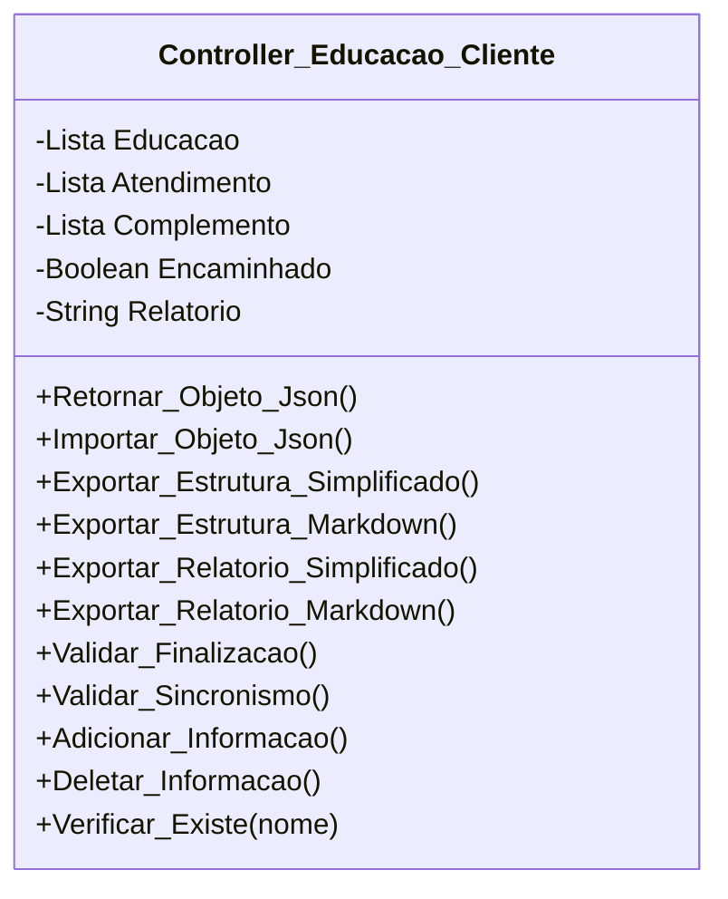

[↩️ Voltar](HOME)
```table-of-contents
```
---
Essa é a classe responsável por gerenciar toda a sessão de educação do cliente durante o atendimento. Suas funções serão:

- Listar e gerenciar atributos de educação do cliente; 
- Listar e Gerenciar atributos de atendimento na casa do cliente, ou seja, o que foi realizado no local;
- permitir a criação e edição de novos atributos de educação/serviço prestado.

Essa classe não sabe quais atributos existem, porém todos eles estarão organizados em uma constate JS que será importada na View para gerar a lista de informações/atendimento passadas ao cliente. Quando clicarmos no check de um item dessa lista, esse elemento será adicionado ao atributo correspondente da classe.

A classe terá uma função que retorna verdadeiro ou falso quando comparado se um item da lista existe cadastrada na classe, caso verdadeiro ele deixa checked na lista da view.

Esses itens de lista irão conter a seguinte estrutura:

```json
{
	titulo: "Nome da Informação",
	descricao: "Descrição geral usado para estruturar a mensagem encaminhada ao cliente"
}
```
## Atributos

- (Lista) **Educacao**: Itens de educação do cliente que o técnico pode preencher no local;
- (Lista) **Atendimento**: Itens de atendimento realizado no local;
- (Lista) **Complemento**: Itens complementares adicionados pelo técnico. Iniciado como Null para validação. 
- (Boolean) **Encaminhado**: Valor que indica se a mensagem foi devidamente encaminhada ao cliente ou não;
- (String) **Relatorio**: Campo que recebe um relatório caso a mensagem não tenha sido encaminhada ao cliente. Por padrão recebe `null`;
## Métodos

### Validar_Finalizacao

Esse método padrão nessa classe deverá validar se o técnico encaminhou a mensagem ao cliente, através do atributo **Encaminhado**. Caso seja falso, verifica o atributo **Relatório**, que caso seja `null`, retorna um array onde o primeiro indice representa false, e o segundo uma mensagem: `Mensagem não encaminhada para o cliente, porém sem justificativa do motivo!`

**Retorno**
	 Lista contendo um valor verdadeiro ou falso, seguindo de uma mensagem para auxiliar o técnico. 
### Verificar_Existe

Método usado para validar ser um nome da lista existe dentro das listas da classe. Caso verdadeiro retorna true para deixar checkado na lista. 

**Parâmetros** 
- *Nome*: Nome do item que será comparado.

**Retorno**
	`True` ou `False` para validar que o item existe dentro da classe.
### Adicionar_Informacao

Método usado para adicionar um item dentro de uma determinada lista.

**Parâmetros** 
- *data*: Objeto que será adicionado a lista;
- *categoria*: Categoria da lista de adição, podendo ser: E Educacao, Atendimento ou Complemento;

**Retorno**
	`True` ou `False` para validar que o item foi devidamente adicionado.
### Deletar_Informacao

Método usado para deletar um item dentro de determinada lista
**Parâmetros** 
-  *nome*: Nome do item que será deletado da lista;
- *categoria*: Categoria da lista de adição, podendo ser: E Educacao, Atendimento ou Complemento;

**Retorno**
	`True` ou `False` para validar que o item foi devidamente removido.
## Diagrama



```json
{
		
	},
	
	info_cliente:{
		nome_cliente: String, //Nome de quem acompanhou a visita;
		parentesco: String, //Titular, Esposa'o, Filho'a, Funcionário, Avó'ô, Tio'a, outro
		parentesco_info: String, //Em caso de outros
		relato_cliente: String //O problema relatado pelo Cleinte;
	},
	
	endereco_info_os:{
		loc: string, //coordenadas puxadas por API;
		anexo_fachada: Bool, //Foto da frente da casa anexada ao mk?
		info_necessaria: Bool, // ordem de serviço gerada com as informações necessárias
	},
	conferencia_tecnica:{
		cabos_utp:[
			{
				cabo: String, // Cabo de rede da WAN, ou outros cabos;
				checagens: [Bool, Bool, Bool], // Checagem se o Cabo é Giga/Teste Powermitter e Ping diretamente no cabo.
				anexo_cabos: Bool, // Foto do cabo de Rede devidamente conectado;
				observacao: String, // Observação adicional quando necessário.
			}
		],
		fontes:{
			mau_contato: Bool, //Checagem de mau contato nas fontes;
			amperagem: Bool, //Checagem se a amperagem da fonte está correta;
			uso: Bool, // Se está sendo usado corretamente, por exemplo, uso de filtro de linha.
			observacao: String //Observações adicionais relacionadas as fontes do local.
		},
		firware_router: Bool, //Se está devidamente atualizado.
		local_equipamento: {
			adequado: Bool, //Se o local está adequado,
			observacao: String //Motivo de ser um local adeguado/não adeguado.
		},
		fibra: {
			sinal: float/String, //Pode ser um valor float, ou uma string "LOS"
			anexo_sinal: Bool, //anexo do sinal de fibra;
			limpeza: Bool, //Se foi realizado a limpeza da fibra;
			observacao: String, // informações relacionadas a fibra.
		},
		conferencia_router:[
			{
				router: String, //Informar se é primeiro ponto, segundo ou ativo do cliente.
				dns: String, //Etecc, Google, outros,
				largura_banda: String, //20MHz, 40MHz, 20/40MHz
				upnp: Bool, //Se está ativado ou não
				ipv6: Bool, //ativado e com protocolo SLAAC,
				acesso_remoto: Bool, //Se está ativo e configurado
				ativos_anormal: {
					verdadeiro: Bool, // Se tem ou não ativos acima do normal.
					observacao: String // Caso ativos esteja acima do normal, quantos são?
				},
				atividade: { //Tempo de funcionamento do ativo acima do esperado
					verdadeiro: Bool,
					observacao: String // Caso ativos estejaligado a mais de 1 semana!
				},
			}
		],
		teste_navegacao: {
			ativos_empresa: Bool,
			ativos_cliente: Bool,
			observacao: String, //observação geral do que foi testado!
		},
		mapa_calor: {
			realizado: Bool,
			pontos_sobra:Bool,
			observacao: String
		},
		ping_adicional:[ //testes além do .bat
			{
				titulo: String, //exe.: Ativos da empresa/cliente
				tipo: String, //ipv4/ipv6
				pacotes: [0,0,0], //enviados, recebidos, perdidos
				latencia: [0,0,0] //min, média, máx
			}	
		],
		observacao_ping: String, // observações relacionadas aos testes gerais, como observações ou motivo de omissão do teste.
		tracert_adicional: [ //testes além do .bat
			{
				ativo: String, //exe.: Notebook da empresa;
				url: String, // ip/url utilizada;
			}
		],
		observacao_tracert: String, // observações relacionadas aos testes gerais, como observações ou motivo de omissão do teste.
		velocidade_adicional:[ //testes além do .bat
			{
				titulo: String, // exe.: Notebook da empresa
				tipo: String, // Wifi/Cabeado
				down: int,
				up: int,
				ping: int
			}
		],
		observacao_velocidade: String, // observações relacionadas aos testes gerais, como observações ou motivo de omissão do teste.
		encaminhar_externa: {
			necessidade: Bool, // Sim/Não
			observacao: String, //motivo da necessidade de encaminhar externa.
		},
		troca_equipamento:{
			ativos:[
				{
					ativo: String, // ONT, ONU, Router, Outros...
					mac: String
				}
			],
			trocas:{
				ativos_retirados:[
					{
						ativo: String, // ONT, ONU, Router, Outros...
						mac: String
					}
				],
				ativos_inseridos:[
					{
						ativo: String, // ONT, ONU, Router, Outros...
						mac: String
					}
				],
				outros_ativos:[ // Em caso de ativos já inseridos no local
					{
						ativo: String, // ONT, ONU, Router, Outros...
						mac: String
					}
				],
			}
		},
	},
	ajuda_interna:{
		verdadeiro: Bool,
		setor: String, // Torre, TI, Supervisão
		nome: String, //Quem auxiliou
	},
	indicacao: {
		solicitado: Bool,
		indicado: Bool, //Cliente passou indicação?
		observacao: String //Numero de contato do indicado!
	},
	
	relato_adicional: String, //Informaçoes adicionais relacionadas a Visita
	relatorio_estabilidade: Strign, //campo para adição do .bat
}
```


