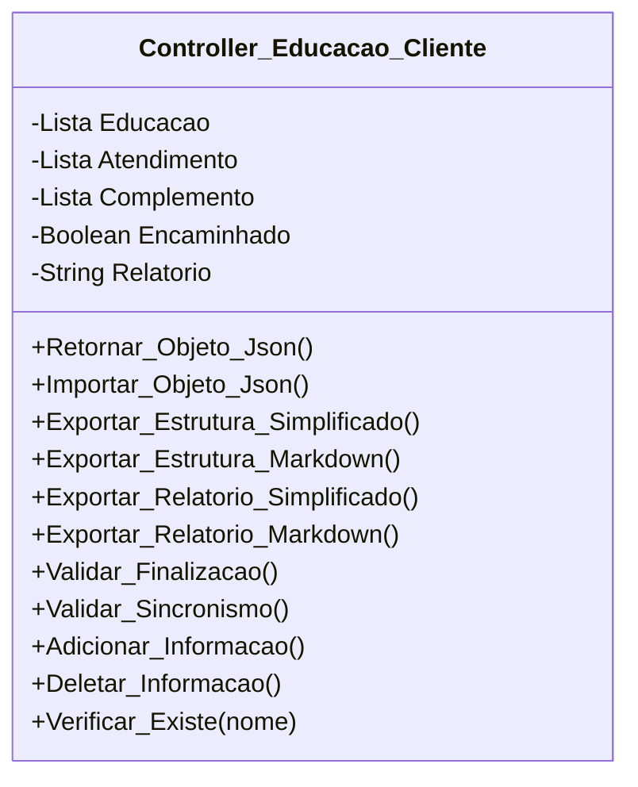

[↩️ Voltar](HOME)
```table-of-contents
```
---
Essa é a classe responsável por gerenciar toda a sessão de educação do cliente durante o atendimento. Suas funções serão:

- Listar e gerenciar atributos de educação do cliente; 
- Listar e Gerenciar atributos de atendimento na casa do cliente, ou seja, o que foi realizado no local;
- permitir a criação e edição de novos atributos de educação/serviço prestado.

Essa classe não sabe quais atributos existem, porém todos eles estarão organizados em uma constate JS que será importada na View para gerar a lista de informações/atendimento passadas ao cliente. Quando clicarmos no check de um item dessa lista, esse elemento será adicionado ao atributo correspondente da classe.

A classe terá uma função que retorna verdadeiro ou falso quando comparado se um item da lista existe cadastrada na classe, caso verdadeiro ele deixa checked na lista da view.

Esses itens de lista irão conter a seguinte estrutura:

```json
{
	titulo: "Nome da Informação",
	descricao: "Descrição geral usado para estruturar a mensagem encaminhada ao cliente"
}
```
## Atributos

- (Lista) **Educacao**: Itens de educação do cliente que o técnico pode preencher no local;
- (Lista) **Atendimento**: Itens de atendimento realizado no local;
- (Lista) **Complemento**: Itens complementares adicionados pelo técnico. Iniciado como Null para validação. 
- (Boolean) **Encaminhado**: Valor que indica se a mensagem foi devidamente encaminhada ao cliente ou não;
- (String) **Relatorio**: Campo que recebe um relatório caso a mensagem não tenha sido encaminhada ao cliente. Por padrão recebe `null`;
## Métodos

### Validar_Finalizacao

Esse método padrão nessa classe deverá validar se o técnico encaminhou a mensagem ao cliente, através do atributo **Encaminhado**. Caso seja falso, verifica o atributo **Relatório**, que caso seja `null`, retorna um array onde o primeiro indice representa false, e o segundo uma mensagem: `Mensagem não encaminhada para o cliente, porém sem justificativa do motivo!`

**Retorno**
	 Lista contendo um valor verdadeiro ou falso, seguindo de uma mensagem para auxiliar o técnico. 
### Verificar_Existe

Método usado para validar ser um nome da lista existe dentro das listas da classe. Caso verdadeiro retorna true para deixar checkado na lista. 

**Parâmetros** 
- *Nome*: Nome do item que será comparado.

**Retorno**
	`True` ou `False` para validar que o item existe dentro da classe.
### Adicionar_Informacao

Método usado para adicionar um item dentro de uma determinada lista.

**Parâmetros** 
- *data*: Objeto que será adicionado a lista;
- *categoria*: Categoria da lista de adição, podendo ser: E Educacao, Atendimento ou Complemento;

**Retorno**
	`True` ou `False` para validar que o item foi devidamente adicionado.
### Deletar_Informacao

Método usado para deletar um item dentro de determinada lista
**Parâmetros** 
-  *nome*: Nome do item que será deletado da lista;
- *categoria*: Categoria da lista de adição, podendo ser: E Educacao, Atendimento ou Complemento;

**Retorno**
	`True` ou `False` para validar que o item foi devidamente removido.
## Diagrama




