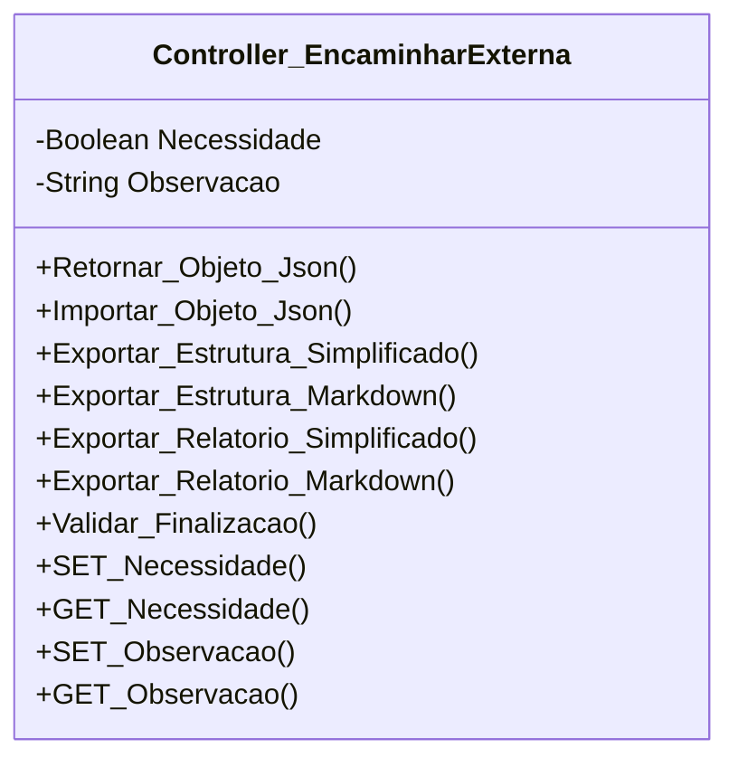

[↩️ Voltar](HOME)
```table-of-contents
```
---

Classe usada para os atributos relacionados a OS's do qual é necessário encaminhar equipe externa.

## Atributos
> [!cite]- Estrutura para uso
> ```
> - `(Tipo_Atributo) Nome_atributo`: Descrição...
> ```

- `(Boolean) Necessidade`: Verdadeiro ou Falso para o caso da necessidade de encaminhar equipe externa.
- `(String) Observacao`: Necessário uma observação do motivo de encaminhar externa quando aplicável. 
## Métodos
> [!cite]- Estrutura para uso
> ```
> ### Nome do Método
> 
> Descrição...
> 
> **Parâmetros** 
> - `Nome_parametro`: Descrição
> 
> **Retorno**
> 	Descrição do retorno.
> ```

### Validar_Finalizacao

Esse método irá validar, que, se for necessário encaminhar externa, o campo de observação da mesma deverá estar preenchido, diferente de `null`. 
## Diagrama




