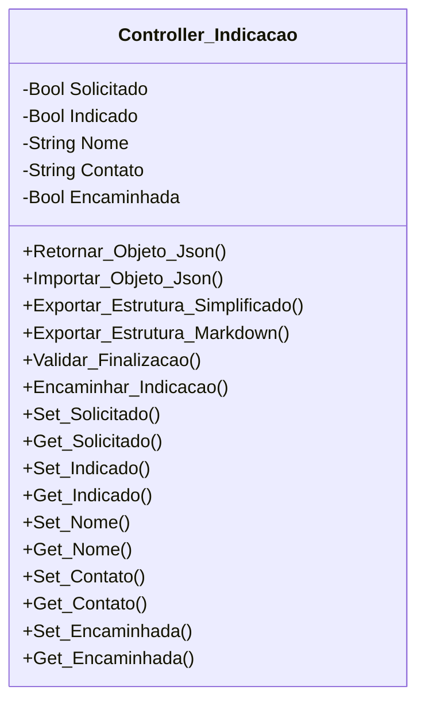

[↩️ Voltar](HOME)
```table-of-contents
```
---

Classe especializada em manejar a indicação do cliente no local.
## Atributos
> [!cite]- Estrutura para uso
> ```
> - `(Tipo_Atributo) Nome_atributo`: Descrição...
> ```

- `(Boolean) Solicitado`: Informa se a indicação foi solicitada ou não;
- `(Boolean) Indicado`: Informa se essa solicitação rendeu alguma indicação;
- `(String) Nome`: Nome da pessoa indicada;
- `(String) Contato`: Contato da pessoa indicada; 
- `(Boolean) Encaminhada`: Informa se esses dados foram encaminhados aos grupos de indicação.
## Métodos
> [!cite]- Estrutura para uso
> ```
> ### Nome do Método
> 
> Descrição...
> 
> **Parâmetros** 
> - `Nome_parametro`: Descrição
> 
> **Retorno**
> 	Descrição do retorno.
> ```
### Encaminhar_Indicacao

Gera um relatório simples de indicação e encaminha ao grupo especializado de indicação através dessa função. E valida após encaminhar tornando o atributo `Encaminhada` igual a `True`
### Validar_Finalizacao

Esse método serve para validar se a informação de indicação quando verdadeiro foi devidamente encaminhada ao grupo especializado do Whatsapp. Caso `Solicitado` seja verdadeiro e `Encaminhada` seja false, o método retorna false com a mensagem: `Você precisa encaminhar a indicação ao grupo no Whatsaspp`
 
**Parâmetros** 
- `Nome_parametro`: Descrição

**Retorno**
	Uma lista do qual o primeiro índice é verdadeiro ou falso, e o segundo é a mensagem caso o retorno seja false.
## Diagrama



```json
{
     
    "conferencia_tecnica": {
        "cabos_utp": [],
        "fontes": {
            "mau_contato": true,
            "amperagem": true,
            "uso": true,
            "observacao": null
        },
        "fibra": {
            "sinal_pto": null,
            "sinal_pathcord": null,
            "sinal_autoisp": null,
            "anexo_sinal": true,
            "limpeza": true,
            "observacao": null
        },
        "conferencia_router": [],
        "teste_navegacao": [
            {
                "ativos_cliente": false,
                "tipo_ativo": "celular",
                "observacao": null
            },
            {
                "ativos_cliente": false,
                "tipo_ativo": "computador",
                "observacao": null
            },
            {
                "ativos_cliente": true,
                "tipo_ativo": "celular",
                "observacao": null
            }
        ],
        "mapa_calor": {
            "realizado": false,
            "pontos_sobra": false,
            "ponto_adicional": null,
            "observacao": null
        },
        "ping_adicional": [],
        "observacao_ping": null,
        "tracert_adicional": [],
        "observacao_tracert": null,
        "velocidade_adicional": [],
        "observacao_velocidade": null,
        "encaminhar_externa": {
            "necessidade": false,
            "observacao": null
        },
        "equipamentos_local": {
            "troca": false,
            "pppoe": null,
            "cod_conexao": null,
            "motivo_troca": "solicitacao_cliente",
            "observacao": null,
            "ativos": [
                {
                    "ativo": "ONT",
                    "mac": "fsdfsdfsdfsd",
                    "inserido": true
                },
                {
                    "ativo": "ONT",
                    "mac": "sdfsdfsdfsd",
                    "inserido": true
                },
                {
                    "ativo": "Router",
                    "mac": "fsdfsdfsdfsd",
                    "inserido": false
                }
            ]
        }
    },

    "relatorio_externo": null,
}
```