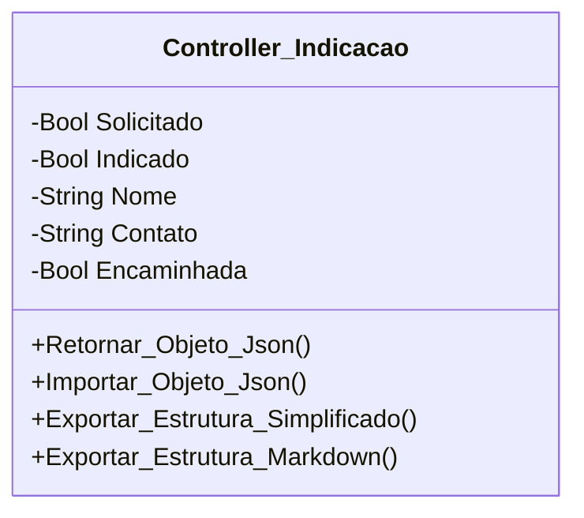

[↩️ Voltar](HOME)
```table-of-contents
```
---

Descrição geral da Classe...

## Atributos
> [!cite]- Estrutura para uso
> ```
> - `(Tipo_Atributo) Nome_atributo`: Descrição...
> ```

- `(Boolean) Solicitado`: Descrição...
- `(Boolean) Indicado`: Descrição...
- `(String) Nome: Descrição...
- `(String) Contato`: Descrição...
- `(Boolean) Encaminhada`: Descrição...
## Métodos
> [!cite]- Estrutura para uso
> ```
> ### Nome do Método
> 
> Descrição...
> 
> **Parâmetros** 
> - `Nome_parametro`: Descrição
> 
> **Retorno**
> 	Descrição do retorno.
> ```


## Diagrama



```json
{
     
    "conferencia_tecnica": {
        "cabos_utp": [],
        "fontes": {
            "mau_contato": true,
            "amperagem": true,
            "uso": true,
            "observacao": null
        },
        "fibra": {
            "sinal_pto": null,
            "sinal_pathcord": null,
            "sinal_autoisp": null,
            "anexo_sinal": true,
            "limpeza": true,
            "observacao": null
        },
        "conferencia_router": [],
        "teste_navegacao": [
            {
                "ativos_cliente": false,
                "tipo_ativo": "celular",
                "observacao": null
            },
            {
                "ativos_cliente": false,
                "tipo_ativo": "computador",
                "observacao": null
            },
            {
                "ativos_cliente": true,
                "tipo_ativo": "celular",
                "observacao": null
            }
        ],
        "mapa_calor": {
            "realizado": false,
            "pontos_sobra": false,
            "ponto_adicional": null,
            "observacao": null
        },
        "ping_adicional": [],
        "observacao_ping": null,
        "tracert_adicional": [],
        "observacao_tracert": null,
        "velocidade_adicional": [],
        "observacao_velocidade": null,
        "encaminhar_externa": {
            "necessidade": false,
            "observacao": null
        },
        "equipamentos_local": {
            "troca": false,
            "pppoe": null,
            "cod_conexao": null,
            "motivo_troca": "solicitacao_cliente",
            "observacao": null,
            "ativos": [
                {
                    "ativo": "ONT",
                    "mac": "fsdfsdfsdfsd",
                    "inserido": true
                },
                {
                    "ativo": "ONT",
                    "mac": "sdfsdfsdfsd",
                    "inserido": true
                },
                {
                    "ativo": "Router",
                    "mac": "fsdfsdfsdfsd",
                    "inserido": false
                }
            ]
        }
    },

    "indicacao": {
        "solicitado": false,
        "indicado": false,
        "nome": null,
        "contato": null,
        "encaminhada": false
    },

    "relato_adicional": null,
    "relatorio_estabilidade": null,
    "relatorio_externo": null,
    "relato_omissao": null,
    "relato_atraso": null
}
```