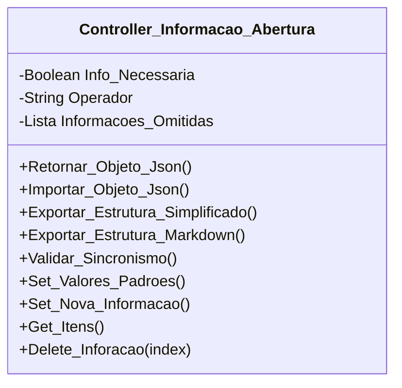

[↩️ Voltar](HOME)
```table-of-contents
```
---

Essa classe tem o objetivo de controlar o contexto de informações anexadas na baixa. Ela irá receber uma lista externa de informações comuns, que foram ou não anexada na abertura da OS, coisas como: Se o cliente é comodato, histórico de quedas e etc. 

A primeiro momento, quando o atributo `Info_Necessaria` estiver true, ele indica que todas as informações necessárias para validar aquela OS foram anexadas. Porém se for alterado para false, significa que o operador da abertura não anexou algo importante. E com isso, o técnico precisará preencher esses dados.

Quando `Info_Necessaria` é igual a `false`, o mesmo se torna válido para gerar estrutura para o sincronismo de informações para serem encaminhadas a planilha.

O atributo `Informacoes_Omitidas` recebe uma lista de Strings que informa qual elemento foi omitido. Quando iniciado, recebe os valores padrões, mas pode ser complementado com novos itens durante o atendimento.  

Algumas das informações padrões são:

- Histórico de Quedas: Quando o operador esquece de anexar a tabela de histórico para analise na OS; 
- Informações de Comodato: Quando o operador esquece de anexar informações relacionadas a comodato, usado para validar troca de equipamentos; 
- Detalhe da OS: Quando o operador não explica bem o motivo da dificuldade do cliente.   
- Data de Contratação: Usado para validar o tempo de casa.  

Quando o método `Validar_Sincronismo` retorna `True` é esperado um payload, que nesse caso, será um markdown estruturado da seguinte forma:

```Markdown
## Relatório de Informações Necessárias:

- Operador: Nome_do_Operador;

**Informações Ausentes**:
- Título da Informação...
  
**Relatório Adicional**
Relatório...
```
## Atributos
> [!cite]- Estrutura para uso
> ```
> - `(Tipo_Atributo) Nome_atributo`: Descrição...
> ```

- `(Boolean) Info_Necessaria`: Booleano que informa se todas as informações foram anexadas (Verdadeiro) ou não (Falso);
- `(String) Operador`: Nome do operador que abriu a OS;
- `(Lista) Informacoes_Omitidas`: Lista de informações que foram omitidas, como Comodato, mapa de calor e etc. Esses dados podem ser adicionados manualmente, mas também, temos uma lista padrão de dados que é usada como estrutura padrão.
## Métodos
> [!cite]- Estrutura para uso
> ```
> ### Nome do Método
> 
> Descrição...
> 
> **Parâmetros** 
> - `Nome_parametro`: Descrição
> 
> **Retorno**
> 	Descrição do retorno.
> ```
### Validar_Sincronismo

Esse método valida se o atributo `Info_Necessaria` é igual a false. Caso verdadeiro, o mesmo retorna true informando que temos dados de sincronismo que devem ser anexados a tabela para analise posterior. 

**Parâmetros** 
- `Nome_parametro`: Descrição

**Retorno**
	Lista do qual o primeiro índice representa `True `ou `False`, e o segundo é o relatório relacionado quando o retorno é true.
### Set_Valores_Padroes

Usado para adicionar os valores padrões que já temos registrados, que são importados de uma variável externa que contem uma lista desses valores. 

## Diagrama




