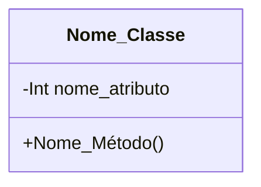

[↩️ Voltar](HOME)
```table-of-contents
```
---

Essa classe tem o objetivo de controlar o contexto de informações anexadas na baixa. Ela irá receber uma lista externa de informações comuns, que foram ou não anexada na abertura da OS, coisas como: Se o cliente é comodato, histórico de quedas e etc. 

A primeiro momento, quando o atributo `Info_Necessaria` estiver true, ele indica que todas as informações necessárias para validar aquela OS foram anexadas. Porém se for alterado para false, significa que o operador da abertura não anexou algo importante. E com isso, o técnico precisará preencher esses dados.

Quando `Info_Necessaria` é igual a `false`, o mesmo se torna válido para gerar estrutura para o sincronismo de informações para serem encaminhadas a planilha.

O atributo `Informacoes_Omitidas` recebe uma lista de objetos que contem um titulo e um boolean que indica se ele está checado ou não: 

```json
{
	Titulo: "Comodato",
	Checked: false,
}
```

## Atributos
> [!cite]- Estrutura para uso
> ```
> - `(Tipo_Atributo) Nome_atributo`: Descrição...
> ```

- `(Boolean) Info_Necessaria`: Booleano que informa se todas as informações foram anexadas (Verdadeiro) ou não (Falso);
- `(String) Operador`: Nome do operador que abriu a OS;
- `(Lista) Informacoes_Omitidas`: Lista de informações que foram omitidas, como Comodato, mapa de calor e etc. Esses dados podem ser adicionados manualmente, mas também, temos uma lista padrão de dados que é usada como estrutura padrão. 
## Métodos
> [!cite]- Estrutura para uso
> ```
> ### Nome do Método
> 
> Descrição...
> 
> **Parâmetros** 
> - `Nome_parametro`: Descrição
> 
> **Retorno**
> 	Descrição do retorno.
> ```


## Diagrama



```json
{
     

        "info_necessaria": true,
        "complemento_info_necessaria": {
            "requerimentos": [],
            "operador": null,
            "info_padrao": {
                "historico": false,
                "comodato": false,
                "descricao": false,
                "contratacao": false
            }
        }
    },
    "conferencia_tecnica": {
        "cabos_utp": [],
        "fontes": {
            "mau_contato": true,
            "amperagem": true,
            "uso": true,
            "observacao": null
        },
        "fibra": {
            "sinal_pto": null,
            "sinal_pathcord": null,
            "sinal_autoisp": null,
            "anexo_sinal": true,
            "limpeza": true,
            "observacao": null
        },
        "conferencia_router": [],
        "teste_navegacao": [
            {
                "ativos_cliente": false,
                "tipo_ativo": "celular",
                "observacao": null
            },
            {
                "ativos_cliente": false,
                "tipo_ativo": "computador",
                "observacao": null
            },
            {
                "ativos_cliente": true,
                "tipo_ativo": "celular",
                "observacao": null
            }
        ],
        "mapa_calor": {
            "realizado": false,
            "pontos_sobra": false,
            "ponto_adicional": null,
            "observacao": null
        },
        "ping_adicional": [],
        "observacao_ping": null,
        "tracert_adicional": [],
        "observacao_tracert": null,
        "velocidade_adicional": [],
        "observacao_velocidade": null,
        "encaminhar_externa": {
            "necessidade": false,
            "observacao": null
        },
        "equipamentos_local": {
            "troca": false,
            "pppoe": null,
            "cod_conexao": null,
            "motivo_troca": "solicitacao_cliente",
            "observacao": null,
            "ativos": [
                {
                    "ativo": "ONT",
                    "mac": "fsdfsdfsdfsd",
                    "inserido": true
                },
                {
                    "ativo": "ONT",
                    "mac": "sdfsdfsdfsd",
                    "inserido": true
                },
                {
                    "ativo": "Router",
                    "mac": "fsdfsdfsdfsd",
                    "inserido": false
                }
            ]
        }
    },
    "ajuda_interna": {
        "verdadeiro": false,
        "setor": "Torre",
        "nome": null
    },
    "indicacao": {
        "solicitado": false,
        "indicado": false,
        "nome": null,
        "contato": null,
        "encaminhada": false
    },
    "educacao_cliente": {},
    "atendimento_cliente": {},
    "complemento_atendimento": [],
    "relato_adicional": null,
    "relatorio_estabilidade": null,
    "relatorio_externo": null,
    "relato_omissao": null,
    "relato_atraso": null
}
```


