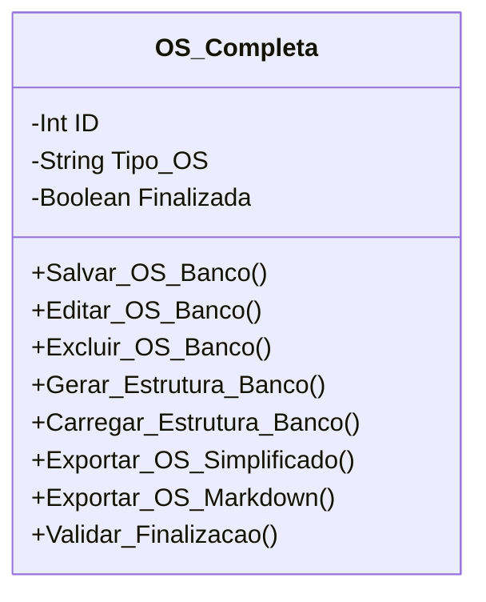

[↩️ Voltar](HOME)
```table-of-contents
```
---

A classe de Ordem de Serviço completa é usada para fazer a gestão geral das OS

## Atributos 

- **ID**: é o identificador único daquela OS localizada no banco de dados;
- **Tipo_OS**: Tipo da Ordem de serviço, que pode ser: Completa, Retenção, LOS, Retirada, Chip;
- **Finalizada**: Atributo boolean que informa se essa OS já foi finalizada;
## Diagrama



