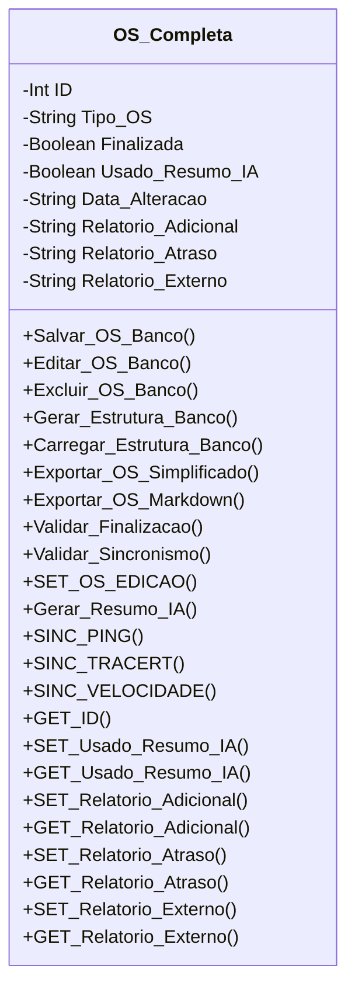

[↩️ Voltar](HOME)
```table-of-contents
```
---

A classe de Ordem de Serviço completa é usada para fazer a gestão geral das OS

## Atributos 

- `(Int) ID`: é o identificador único daquela OS localizada no banco de dados;
- `(String) Tipo_OS`: Tipo da Ordem de serviço, que pode ser: Completa, Retenção, LOS, Retirada, Chip;
- `(Boolean) Finalizada`: Atributo boolean que informa se essa OS já foi finalizada;
- `(Boolean) Usado_Resumo_IA`: Atributo boolean que informa se essa OS foi submetida ao resumo por IA;
- `(Boolean) Data_Alteracao`: Atributo que armazena a data e hora que essa OS foi modificada;
- `(String) Relatorio_Adicional`: Caso necessário, o técnico pode adicionar um relatório adicional sobre a visita;
- `(String) Relatorio_Atraso`: Pode haver momentos em que o técnico tenha um atendimento mais demorado durante os procedimentos. E para esses momentos que esse campo foi criado, para o técnico justificar o motivo do atraso.
- `(String) Relatorio_Externo`: Pode haver momentos em que o técnico tenha que realizar o teste de estabilidade com métodos antigos (.BAT). Esse campo serve para anexar esse relatório. 
## Métodos
> [!cite]- Estrutura para uso
> ```
> ### Nome do Método
> 
> Descrição...
> 
> **Parâmetros** 
> - `Nome_parametro`: Descrição
> 
> **Retorno**
> 	Descrição do retorno.
> ```
### SET_OS_EDICAO

Esse método será usado para salvar o ID da OS no LocalStorage enquanto a mesma não é encerrada. Assim, enquanto estivermos editando a mesma, não perdemos os dados. 
### Gerar_Resumo_IA

Esse método da classe gera o relatório Markdown junto com um prompt pré criado, encaminha essa mensagem a IA, e retorna o resumo de todos o relatório, que por sua vez é somando com o valor do atributo `Relatorio_Adicional`. E altera o atributo `Usado_Resumo_IA` para `true`.
### SINC_PING

Essa função captura os pings que foram retornados dos testes externos, e adiciona ao objeto instanciado de Pings. 
### SINC_TRACERT

Essa função captura os Tracert que foram retornados dos testes externos, e adiciona ao objeto instanciado de Tracert. 
### SINC_VELOCIDADE

Essa função captura os Velocidade que foram retornados dos testes externos, e adiciona ao objeto instanciado de Velocidade. 

## Diagrama



