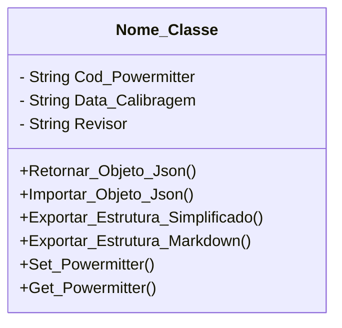

[↩️ Voltar](HOME)
```table-of-contents
```
---

Descrição geral da Classe...

## Atributos

- `(String) Cod_Powermitter`: Código do Powermitter cadastrado no sistema do Central;
- `(String) Data_Calibragem`: Data da ultima calibragem;
- `(String) Revisor`: Nome de quem realizou a revisão do powermitter do técnico;
- 
## Métodos

### Set_Powermitter

Esse método define os valores iniciais do powermitter na criação da ficha da OS.

**Parâmetros** 
- `Powemitter`: Um array contendo o código, data de revisão e revisor.
### Get_Powermitter

Esse método serve para capturar os dados do powermitter cadastrado. 

**Retorno**
	- `Powemitter`: Um array contendo o código, data de revisão e revisor.
### Nome do Método

Descrição...

**Parâmetros** 
- `Nome_parametro`: Descrição

**Retorno**
	Descrição do retorno.
## Diagrama




