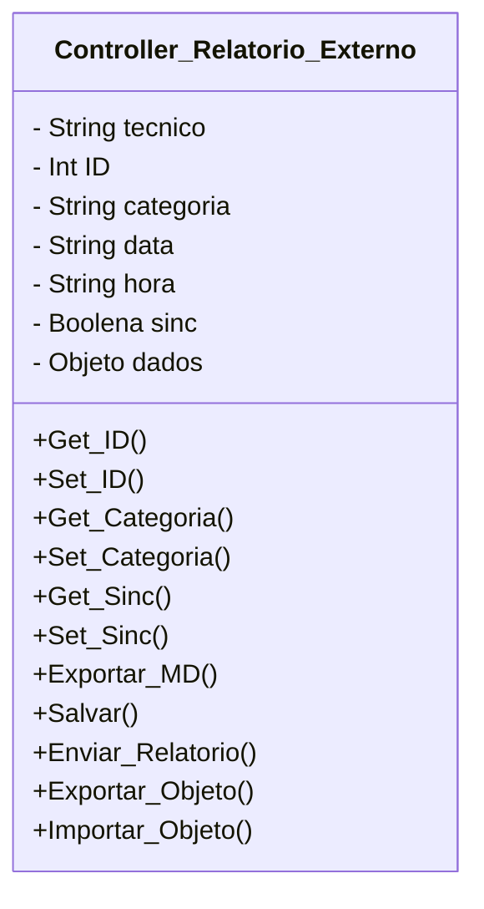

[↩️ Voltar](HOME)
```table-of-contents
```
---

Essa é a classe responsável pela gestão de relatórios que o técnico pode soltar por diversos motivos. 
## Atributos
> [!cite]- Estrutura para uso
> ```
> - `(Tipo_Atributo) Nome_atributo`: Descrição...
> ```

- `(String) tecnico`: Nome do técncio que encaminhou os dados
- `(Int) ID`: Identificador do item caso ele já esteja no banco local. Por padrão inicia `null`
- `(String) categoria`: Qual página da Planilha irá usar...
- `(String) data`: Data DD/MM/AAAA que foi encaminhado a informação...
- `(String) hora`: Hora HH:MM que foi encaminhado a informação...
- `(Boolena) sinc`: Informa se esse dado já foi sincronizado; Por padrão inicia como `false`
- `(Objeto) dados`: Esse é o objeto do relatório que será criado de acordo com a categoria definida na classe.
## Métodos
> [!cite]- Estrutura para uso
> ```
> ### Nome do Método
> 
> Descrição...
> 
> **Parâmetros** 
> - `Nome_parametro`: Descrição
> 
> **Retorno**
> 	Descrição do retorno.
> ```
### Set_Categoria

Essa função é usada para definir a categoria do relatório. E de acordo com essa categoria, ele define a classe que será instanciada ao atributo dados. 

**Parâmetros** 
- `Categoria`: A categoria valida que existe na lista de categorias. 

**Retorno**
	Retorna `true` se todo o processo foi realizado com sucesso, ou `false` caso tenha tido algum erro. 
### Exportar_MD

Essa função estrutura todos os dados necessários da classe para a formatação MD, para que possamos ler esses dados na lista de relatórios do APP. 

**Retorno**
	Retorna uma String convertida em MD dos dados armazenados.
### Enviar_Relatorio

Essa função será usada para exportar o relatório para a planilha. Caso ela receba algum erro na função responsável pela exportação, a mesma irá definir o atributo `sinc` como `false` para que possamos sincronizar mais tarde, e salvar a alteração no banco de dados, criando um novo registro ou atualizando caso o ID já esteja registrado.

**Retorno**
	Retorna `true` caso a exportação tenha sido um sucesso, ou `false` caso tenha tido alguma dificuldade. 
### Salvar

Essa função irá salvar o relatório no banco. Porém, se o mesmo possuir ID já registrado, irá apenas editar os dados que já foram salvos. 

**Retorno**
	Descrição do retorno.
### Exportar_Objeto e Importar_Objeto

São métodos que irão encaminhar o objeto devidamente estruturado. Ele será integrado ao corpo da classe principal para encaminhar toda a estrutura para ser enviada ao relatório, e salvar no banco de dados. 
## Diagrama




