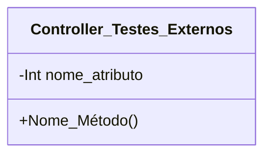

[↩️ Voltar](HOME)
```table-of-contents
```
---

Essa classe é usada para configurar o comportamento do payload dos testes externos que podemos receber através do NETScanQR ou outro testador que forem criados mais pra frente. Atualmente o NetScan encaminha um JSON estruturado para o CentralOS com uma estrutura pré estabelecida. 

Quando essa estrutura chegar na classe, a mesma irá ser filtrada para preencher os atributos. E as listas de Velocidade, Ping e Tracert receberão as seguintes estruturas:

`Velocidade:
```json
{
	Status: "Success",
	Share_url: "https://www.speedtest.net/result/c/23176056-843c-4027-a642-fb6f74e062c1",
	Raw_Log: "",//JSON com os dados brutos do Teste
	Server:{
		ID:27674,
		Name: "WSNET Fibra",
		Location: "Itanhaém"
	},
	Data:{
		"download_mbps": 351.26,
        "upload_mbps": 233.51,
        "ping_ms": 45.856
	}
}
```

`Ping:`
```json

```

`Ping:`
```Tracert

```
## Atributos
> [!cite]- Estrutura para uso
> ```
> - `(Tipo_Atributo) Nome_atributo`: Descrição...
> ```

- `(Lista) Velocidade`: Atributo relacionado ao teste de velocidade;
- `(Lista) Ping`: Atributo relacionado aos testes de Ping;
- `(Lista) Tracert`: Atributo relacionado aos testes de Tracert;
- `(String) Host`: Nome da Máquina que recebeu os testes;
- `(String) Aplicativo`: Nome do sistema que realizou os testes;
- `(String) OS`: Sistema Operacional que rodou o teste;
- `(String) Versao`: Versão do sistema que realizou os testes;
- 
## Métodos
> [!cite]- Estrutura para uso
> ```
> ### Nome do Método
> 
> Descrição...
> 
> **Parâmetros** 
> - `Nome_parametro`: Descrição
> 
> **Retorno**
> 	Descrição do retorno.
> ```


## Diagrama




