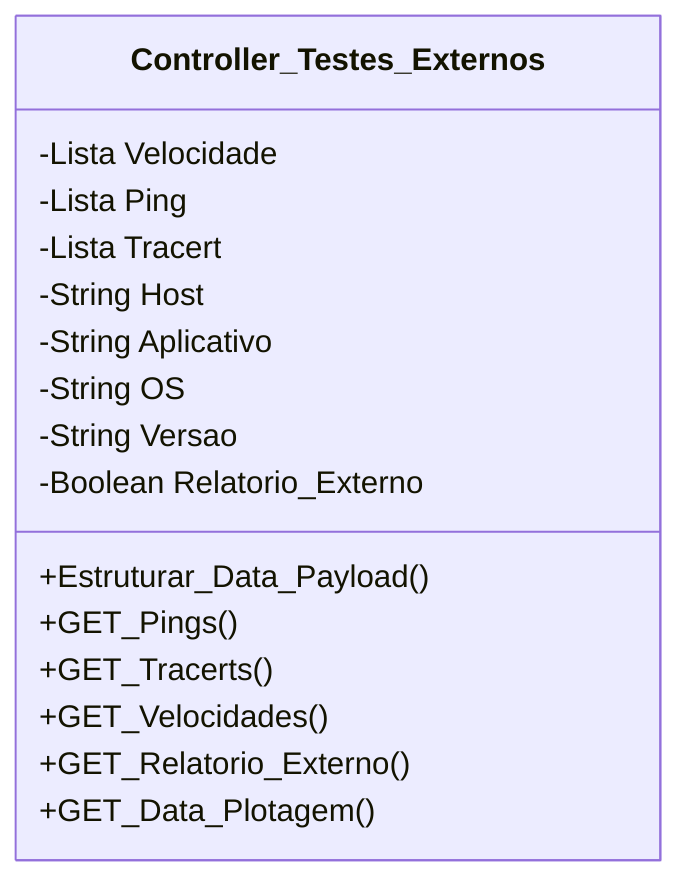

[↩️ Voltar](HOME)
```table-of-contents
```
---

Essa classe é usada para configurar o comportamento do payload dos testes externos que podemos receber através do NETScanQR ou outro testador que forem criados mais pra frente. Atualmente o NetScan encaminha um JSON estruturado para o CentralOS com uma estrutura pré estabelecida. 

Quando essa estrutura chegar na classe, a mesma irá ser filtrada para preencher os atributos. E as listas de Velocidade, Ping e Tracert receberão as seguintes estruturas:

`Velocidade:
```json
{
	Status: "Success",
	Share_url: "https://www.speedtest.net/result/c/23176056-843c-4027-a642-fb6f74e062c1",
	Raw_Log: "",//JSON com os dados brutos do Teste
	Server:{
		ID:27674,
		Name: "WSNET Fibra",
		Location: "Itanhaém"
	},
	Data:{
		"download_mbps": 351.26,
        "upload_mbps": 233.51,
        "ping_ms": 45.856
	}
}
```

`Ping:`
```json
{
	"target": "google.com",
    "protocol": "IPv6",
    "status": "fail",
    "packets_sent": 200,
    "packets_received": 0,
    "packets_lost": 200,
    "packet_loss_percent": 100.0,
    "latency_ms": {
        "min": 0.0,
        "avg": 0.0,
        "max": 0.0
    },
    "raw_log": "",//JSON com os dados brutos do Teste
}
```

`Tracert:`
```json
{
	"target": "youtube.com",
	"protocol": "IPv6",
	"status": "fail",
	"total_hops": 0,
	"hops": [],
	"raw_log": "", //JSON com os dados brutos do Teste
}
```
## Atributos
> [!cite]- Estrutura para uso
> ```
> - `(Tipo_Atributo) Nome_atributo`: Descrição...
> ```

- `(Lista) Velocidade`: Atributo relacionado ao teste de velocidade;
- `(Lista) Ping`: Atributo relacionado aos testes de Ping;
- `(Lista) Tracert`: Atributo relacionado aos testes de Tracert;
- `(String) Host`: Nome da Máquina que recebeu os testes;
- `(String) Aplicativo`: Nome do sistema que realizou os testes;
- `(String) OS`: Sistema Operacional que rodou o teste;
- `(String) Versao`: Versão do sistema que realizou os testes;
- `(Boolean) Relatorio_Externo`: Esse atributo informa se foi anexado algum relatório externo. 

## Métodos
> [!cite]- Estrutura para uso
> ```
> ### Nome do Método
> 
> Descrição...
> 
> **Parâmetros** 
> - `Nome_parametro`: Descrição
> 
> **Retorno**
> 	Descrição do retorno.
> ```

### Estruturar_Data_Payload

Esse método serve para estruturar todo o JSON que é enviado pelo NETScanQR, destrinchando todos os dados e estruturando em seus respectivos attibutos. Após finalizar a inserção de todos os dados, a função altera `Relatorio_Externo` para `True`.

**Parâmetros** 
- `Payload`: Data JSON que vem do netscan

**Retorno**
	Retorna `True` quando toda a adequação é bem sucedida, ou `False` quando ocorre algum erro como primeiro índice do array, e uma mensagem como segundo índice, podendo ser: `Teste Externo carregado com sucesso!` quando `true`, ou `Detectado um erro ao tentar subir o teste externo: Erro...` quando `false`. 

### GET_Pings

Retorna a lista de Pings estruturado para ser renderizado na ficha. Por padrão, não permite edição. 
### GET_Tracerts

Retorna a lista de Tracerts estruturado para ser renderizado na ficha. Por padrão, não permite edição. 
### GET_Velocidades

Retorna a lista de Velocidades estruturado para ser renderizado na ficha. Por padrão, não permite edição. 
### GET_Relatorio_Externo

Vai retornar se o relatório externo foi anexado ou não, permitindo assim, validar dentro da interface. 
### GET_Data_Plotagem

Retorna o relatório estruturado para plottagem no app.
## Diagrama




